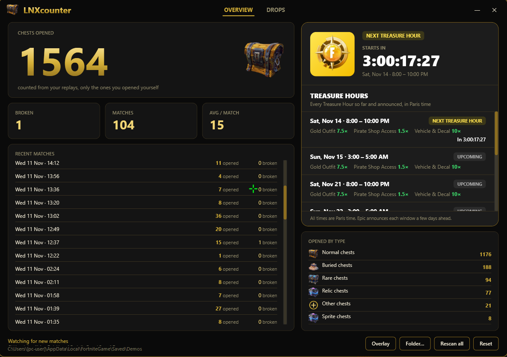
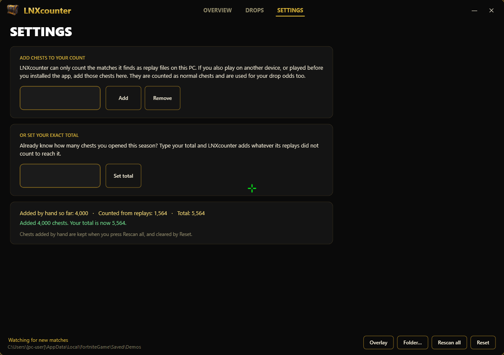
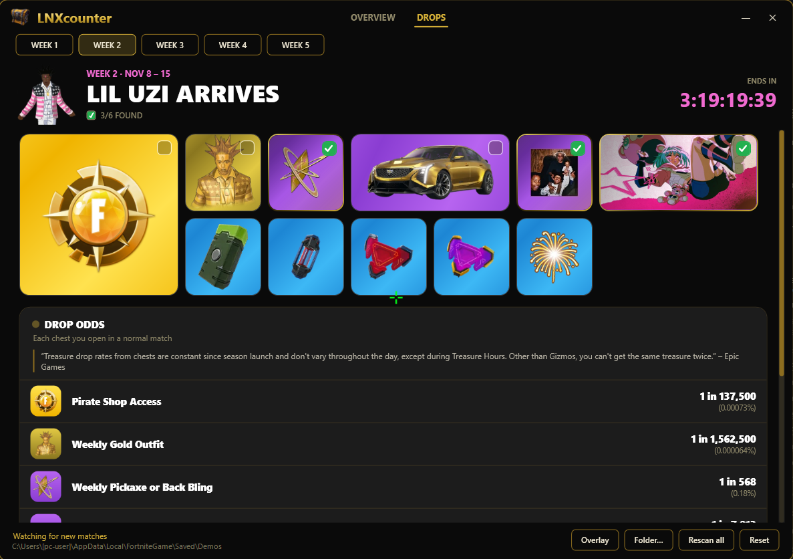
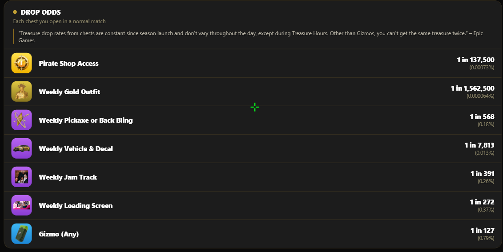
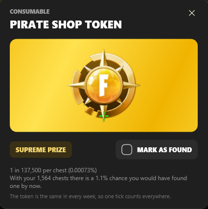
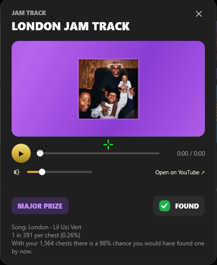

# LNXcounter

**A Fortnite chest counter for Windows that works completely offline.**
It reads the replay files your own game already saves and counts **only the chests you open or break yourself**, match after match. It also tracks the **Treasure Hunters** mini-season drops, shows every **Treasure Hour** in Paris time, and has a small always-on-top overlay.

No login, no account, no data sent anywhere. Everything happens on your PC.

[](https://ko-fi.com/lnxidk) Totally optional: if you enjoy the app and want to chip in, you can. If not, no worries.



---

## Features

### 📦 Chest counter
- Total chests **opened** and **broken**, number of matches, and the average per match
- Breakdown by chest type (normal, rare, buried, relic, sprite…)
- List of your recent matches with the number of chests opened in each
- A new match is picked up automatically **about 8–20 seconds after it ends**, no need to restart or click anything
- Your progress is saved on your PC between launches
- **Add chests from other devices** in the Settings tab (see below)

### ⚙️ Settings: add chests from other devices
LNXcounter can only count the matches it finds as replay files **on the PC it runs on**. If you also play on another device (console, another PC, phone), or you played before installing the app, those chests are not in your count. The **Settings** tab lets you add them yourself:



- **Add / Remove:** type a number and press **Add** to add chests, or **Remove** to take some back (the Enter key works too)
- **Set your exact total:** already know how many chests you opened this season? Type your total and press **Set total**. LNXcounter adds whatever its replays did not count to reach it
- The summary box shows how many chests were **added by hand**, how many were **counted from replays**, and your **total**
- Chests added by hand are counted as **normal chests**, and they are also used for the drop odds, the overlay and the tray tooltip. The average per match is not affected
- They are **kept when you press Rescan all**, and cleared by **Reset**
- **Start with Windows:** one checkbox opens LNXcounter quietly in the tray when you log in (the same switch is in the right-click menu of the tray icon and of the overlay)
- **Export to CSV or PDF:** save your chests **per day, per week (Monday to Sunday) or per month**. CSV opens in Excel / Google Sheets (with chests by type); PDF is a small black and gold report with totals, a bar per period and the treasures you found
- **Treasure Hour alert:** a pop-up with a short chime slides in at the top right of your screen when a Treasure Hour starts, plus a silent warning 30 minutes before and one with the chime 10 minutes before (switch them off or press *Test* in Settings)
- **Your language:** French, Spanish or German when Windows is set to it (English otherwise), and your Fortnite name next to the app name
- **Chest map:** an eye on every match shows where each chest you opened was on the map
- **Records, streak and an optional goal** above the matches list, and how many chests you opened during Treasure Hours
- **Backup and restore:** save all your stats to one file and load it back, for example on a new PC
- **Updates:** the app checks GitHub for a new version (can be switched off). When one exists, a red dot shows on *SETTINGS* and the *Updates* card says *New update available vX.Y.Z*; *Update now* installs it and restarts. You can also run `LNXcounter.exe -up` in a terminal opened in the exe folder

### ⏰ Treasure Hours (all times in Paris time)
- The next Treasure Hour with a **live countdown** (days : hours : minutes : seconds)
- The full list of past and upcoming windows with their boosts (Gold Outfit, Pirate Shop Access, Vehicle & Decal)
- Switches to **LIVE NOW** while a window is running, and past windows are dimmed
- While a Treasure Hour is on, the drop rates on the Drops page are **multiplied by the boost** and turn **lucky green**
- Every time shown in the app (Treasure Hours, overlay, tray menu, match times) is converted to **Paris time**, whatever your PC's time zone is

### 🏴‍☠️ Drops: Treasure Hunters mini-season
Weeks 1 to 5, each with its own character, rewards and colors.



- Every reward of the week as a card (outfit, pickaxe or back bling, vehicle decal, jam track, loading screen and the five gizmos), with the rarity colors
- Tick **"Mark as found"** on what you got. The **Pirate Shop Token** is the same every week, so ticking it once counts for all weeks
- The **week ends and the next one starts automatically**: a finished week turns dark and black-and-white, and the page jumps to the new week by itself
- A live **"ends in" countdown** for the current week

#### Drop odds and "could I already have it?"
Each reward has its official drop rate, and the app turns your own chest count into a chance of having already found it.



Click any reward to see its details. For every item the app **calculates your possible odds of already having it**, based on how many chests you have opened in total:



#### Rewards found in your replays
When a chest gives a Treasure Hunters reward, the game shows a golden chest in the match, and that is written in the replay too. LNXcounter reads it:

- A reward you got is **ticked as found for you** on the Drops page (the Pirate Shop Access, and the weekly outfit, pickaxe or back bling, vehicle decal, jam track and loading screen)
- The match in **Recent matches** gets a **★** and a tooltip with what was found and when (`★ You: …`, `☆ Nearby player: …`). Rewards found by other players near you are listed too
- **Gizmos** you equip in a match are listed the same way. A gizmo you get but never equip is not written in the replay, so it cannot be seen
- Only what happens **near you** is recorded by the game, so a reward found far away is not in the file
- Matches counted by an older version are read again once (while their replay is still on your PC)

> This reading is new. The prize ids for the weeks that are still hidden (3 to 5) are added as soon as they are known.

#### Loading screen preview
Click a loading screen reward and press **▶ PREVIEW** to see it full screen in 16:9, with the animated "connecting" dots and random Fortnite tips, just like in the game.


#### Jam track preview 🎵
Click a jam track reward to **listen to its song** right inside the app, with play / pause, a progress bar you can drag, and a **volume slider** (your volume is remembered). There is also an **"Open on YouTube"** button if you want to open the song in your browser.



### 🪟 Overlay and tray
- A small **overlay** you can keep on top of other windows: your total, this session's count, the last match and the next Treasure Hour
- Move it to any corner of the screen, or collapse it to just the total
- Closing the window **keeps the app running in the system tray**. Left-click the tray icon to reopen it, right-click for the menu
- Optional **start with Windows**

---

## Download and install

1. Go to the [**Releases**](../../releases) page and download **`LNXcounter.exe`**.
2. Run it. It is a single file and there is nothing to install.

> **Windows SmartScreen warning:** the app is not code-signed, so Windows may show *"Windows protected your PC"*. Click **More info → Run anyway**.

See the [**changelog**](CHANGELOG.md) for what changed in every version.

## Requirements

### Supported Windows versions

| System | Supported? |
| --- | --- |
| **Windows 11** (x64) | ✅ Yes. This is what the app is developed and tested on |
| **Windows 10** (x64), version 1607 or newer (22H2 recommended) | ✅ Yes, this is the oldest version the .NET 10 runtime it is built on supports |
| Windows 11 on ARM | ⚠️ Should work through Windows' built-in x64 emulation, but it is untested |
| Windows 7, 8, 8.1 and 32-bit Windows | ❌ No |
| macOS, Linux | ❌ No (it is a Windows-only WPF app, and Fortnite replays are read from the Windows install) |

- **Nothing to install:** the exe contains the .NET runtime, so you do **not** need to install .NET.
- **Fortnite replays on:** the game saves them by default in `%LOCALAPPDATA%\FortniteGame\Saved\Demos`. If yours are somewhere else, click **Folder…** in the app to choose the folder.
- **Jam track preview only:** the Microsoft Edge **WebView2 runtime**. It comes with Windows 11 and with most up-to-date Windows 10 installs. If it is missing, the app tells you and you can [download it from Microsoft](https://developer.microsoft.com/microsoft-edge/webview2/). Everything else works without it.
- **Disk:** the exe is about 170 MB (it is not compressed, which is what keeps its RAM use low, see below).

## Light on your PC

LNXcounter is meant to sit in the tray while you play, so it is built to stay out of the way:

- **Starts in Windows' Efficiency mode:** the app marks itself as a background process every time it starts. It runs on the power-efficient cores at lower priority and never competes with Fortnite for the CPU. On Windows 11 you can see the Efficiency mode leaf next to it in Task Manager; on Windows 10 it applies too, just without the leaf icon.
- **Small RAM footprint:** about **15–45 MB** of working memory while it sits in the tray and about **40–70 MB** with the window open, instead of the ~290 MB it used before (measured in Task Manager's working set on Windows 11). It regularly gives unused memory back to Windows, especially when the window is hidden or after it has read a match.
- **The song preview cleans up after itself:** the jam track player runs in a stripped-down browser (no GPU process, a single renderer), and it is shut down completely about 20 seconds after the song stops, so it uses no memory when you are not listening. If you only pause, it is kept for 3 minutes and then released too.

## How it works

LNXcounter reads the `.replay` files that Fortnite saves after each match and looks at which chests *you* searched. Nothing is injected into the game and nothing is read from the game's memory, so it can't affect your account.

Because it works from replay files, a match is counted once the game has finished writing it. If a replay can't be read (for example after a game update changes the format), the status bar tells you.

## Build from source

You need the [.NET 10 SDK](https://dotnet.microsoft.com/download).

```bash
dotnet build -c Release
```

To produce the single-file exe:

```bash
dotnet publish -c Release -r win-x64 --self-contained true -p:PublishSingleFile=true -p:IncludeNativeLibrariesForSelfExtract=true -p:EnableCompressionInSingleFile=false -o dist
```

Compression is turned off on purpose: a compressed single-file exe makes .NET unpack all its libraries into private memory, which costs about 70 MB more RAM.

Built with WPF on .NET, [FortniteReplayReader](https://github.com/Shiqan/FortniteReplayDecompressor) for reading replays and Microsoft WebView2 for the song preview.

## Contact

Questions, bugs or ideas? You can DM me on Discord:

- **User:** `reubeuparterre`
- **ID:** `989960762254557234`

## Credits and disclaimer

- Treasure Hours, drop rates and the weekly rewards come from [fortnite.bot/treasure](https://fortnite.bot/treasure) and from Epic Games' announcements.
- The idea of reading the Treasure Hunters rewards (golden chest prize ids, equipped gizmos) from the replay was inspired by [LED-N's Fortnite-ChestCounter](https://github.com/LED-N/Fortnite-ChestCounter) (MIT). LNXcounter uses its own code. The prize ids of the known rewards come from that project's public list.
- Jam track previews play the official YouTube videos through YouTube's own embedded player. Nothing is downloaded or copied.
- **LNXcounter is a fan-made tool. It is not affiliated with, endorsed by or sponsored by Epic Games.** Fortnite and all related names, images and logos are trademarks of Epic Games, Inc.
